# CVAT Attribute Annotation Guide for Mound Symbols

*Description of CVAT attributes (where annotations are marked and the model is trained on them)*

> **The surroundings around the symbols are also important for the model, so they must be marked as well. Attributes must also be corrected on objects that are NOT MOUNDS but which the model has marked as mounds.**

> **NB! "Crossed" and "Overlapped" do not mean only that the symbol itself is directly "crossed" or "overlapped" — it also applies when its immediate surroundings are. See examples below.**

Some of the examples below show cases affected by more than one additional symbol/line, etc.

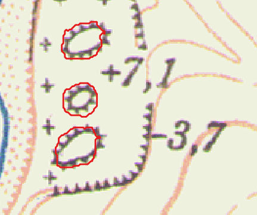

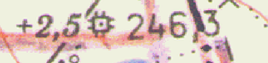

We count these as mounds — the lower one is a triangulation point!!!

## True / False Attributes

- **`affected_by_colored_pencil`** — presence of additional coloring (pencil, pen, marker, etc. on the map)

  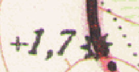
  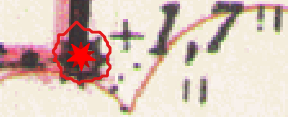

- **`blurred_or_bad_print`** — smudged / faint print

  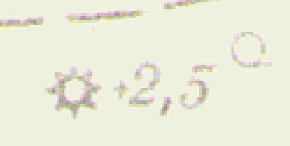

- **`crossed_by_contour`** — crossed by a contour line / isoline

  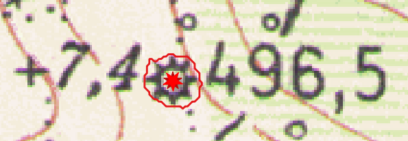

- **`crossed_by_forestation_line`** — crossed by forest / forest symbols / vineyard; the background does not necessarily have to be green

  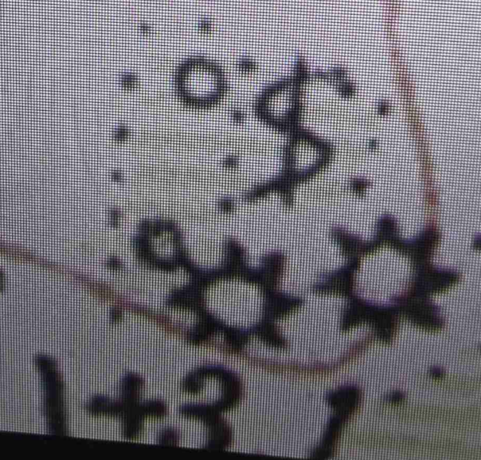

- **`crossed_by_grid`** — crossed by the map grid (grid lines on 1:5,000 scale maps)

  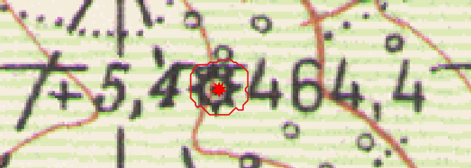

- **`crossed_by_powerline`** — crossed by a power line

  There are various types of symbols on the map for power lines/transmission lines. Some may no longer exist on the ground (they may be from old poles), but that doesn't matter for computer vision 🙂!

  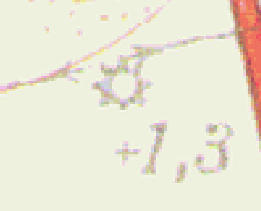
  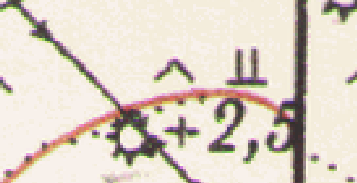
  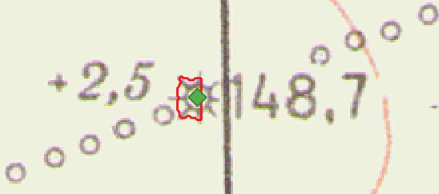

  More examples of power lines/transmission lines:

  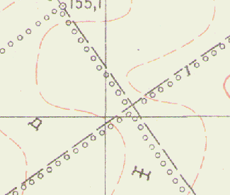

  All these lines with unfilled circles are power lines.

  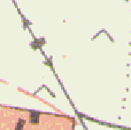

  The ones with arrows are clear.

- **`crossed_by_road`** — crossed by a road — dirt/field/forest road, asphalt, railway line, etc.

  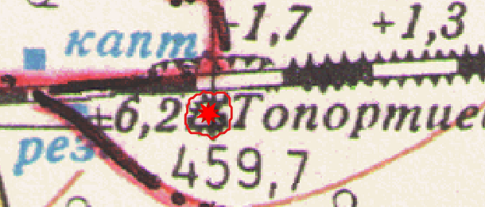
  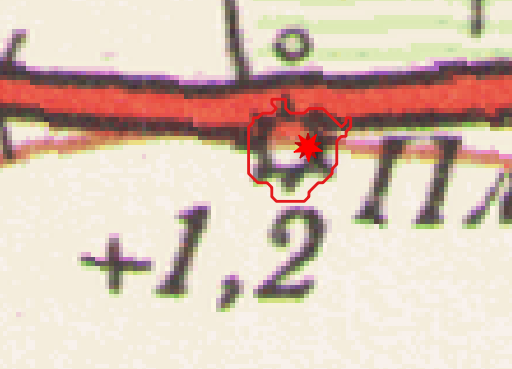

- **`has_absolute_elevation_mark`** — has an absolute elevation (above sea level) mark

  

- **`has_relative_height_mark`** — has a height value relative to the surrounding terrain; if the height value is shared among several symbols, mark `true` for each of them

  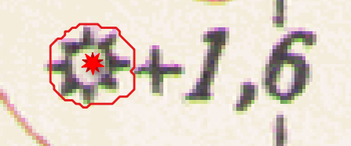
  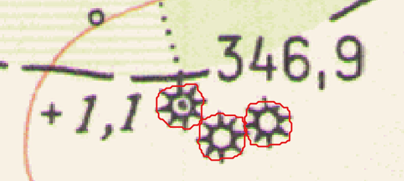

  In this case it is clear which symbol the value belongs to — the one with the absolute elevation mark and the dot inside it (a dot inside the mound symbol means it has an absolute elevation above sea level).

  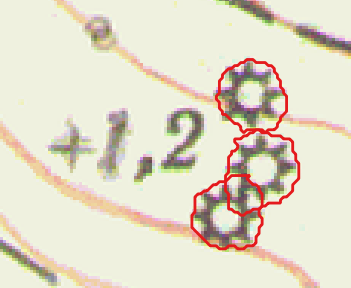

  Here it is not clear which symbol the value belongs to, so we mark `true` for all three.

  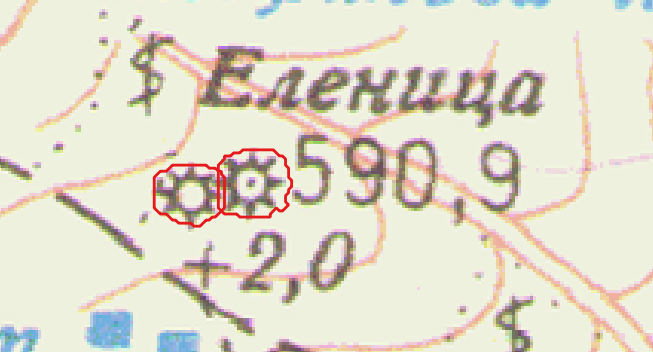

  Here we mark the absolute elevation for the eastern mound, and the relative height for both mounds.

- **`has_trig_point`** — has a triangulation point

  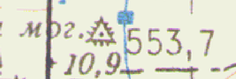
  

- **`overlaps_other_mound`** — overlaps with another mound; there are various examples, also depending on the presence of other symbols

  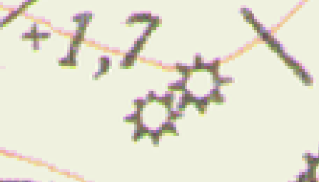
  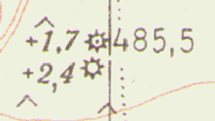

  All of these must be marked as `overlaps_other_mound`.

  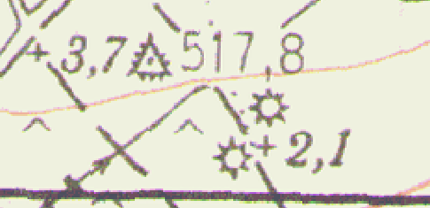

  Only the two at the SE end should be marked `overlaps_other_mound`.

## Multi-Value Attributes

- **`water_line_crossing`**:

  | Value | Meaning |
  | :--- | :--- |
  | `none` | No water line crosses this symbol. |
  | `surface` | A stream or river crosses it — *this is a data error, since the mound is an elevated landform and surface water flows through low-lying areas* — **THIS IS NOT ALWAYS THE CASE, because sometimes there are small streams that are not in a gully/ravine (see below).** |
  | `underground` | A pipe or culvert crosses it, which can run under anything and is normal. |
  | `unreviewed` | No one has reviewed this yet. |

  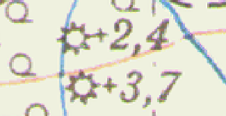

  `surface`

## Additional Examples

- `crossed_by_forestation_line` — `true`
- `has_absolute_elevation_mark` — `true`
- `has_relative_height_mark` — `true`

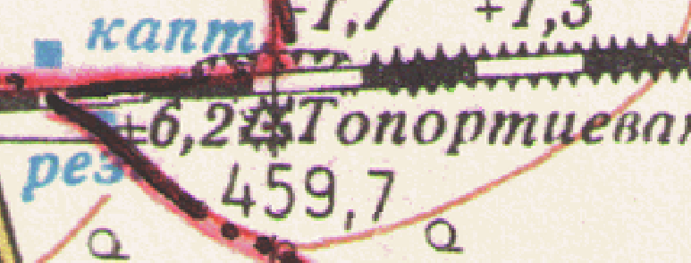

- `crossed_by_grid` — `true`
- `crossed_by_road` — `true`
- `has_absolute_elevation_mark` — `true`
- `has_relative_height_mark` — `true`
- `has_trig_point` — `true`
